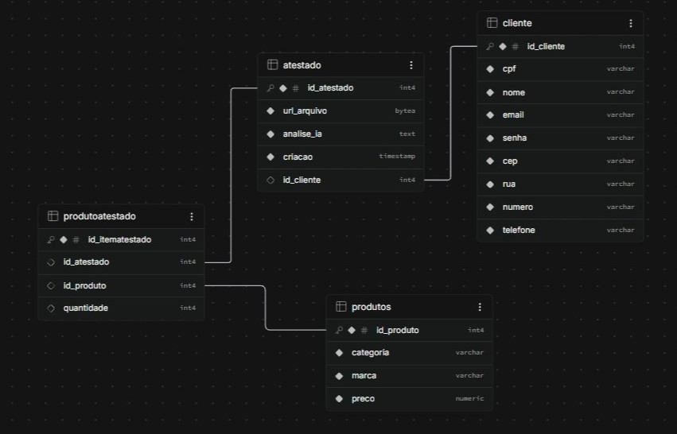

# House Security

> **Vídeo Final de Apresentação e Demonstração (5 a 10 min):** **[COLE AQUI O LINK DO VÍDEO FINAL NO YOUTUBE / DRIVE / LOOM]**  
> **Apresentação do Projeto (Pitch Deck):** **[COLE AQUI O LINK DOS SLIDES NO CANVA OU ARQUIVO PDF]**

---

## Sumário
- [1. Sobre o Projeto](#1-sobre-o-projeto)
- [2. ODS Escolhida](#2-ods-escolhida)
- [3. O Problema Real](#3-o-problema-real)
- [4. A Solução com Inteligência Artificial](#4-a-solução-com-inteligência-artificial)
- [5. Público-Alvo](#5-público-alvo)
- [6. Modelagem de Dados (UML)](#6-modelagem-de-dados-uml)
- [7. Arquitetura do Sistema e Diagramas (Modelo C4)](#7-arquitetura-do-sistema-e-diagramas-modelo-c4)
- [8. Decisões Tecnológicas e Protocolos](#8-decisões-tecnológicas-e-protocolos)
- [9. Estrutura de Dados (MER) e Integração com IA](#9-estrutura-de-dados-mer-e-integração-com-ia)
- [10. Interface da Aplicação, Sessão e Integração com a API](#10-interface-da-aplicação-sessão-e-integração-com-a-api)
- [11. Infraestrutura em Nuvem (SaaS) e MVP](#11-infraestrutura-em-nuvem-saas-e-mvp)
- [12. Apresentação Final (Pitch Deck) e Retrospectiva](#12-apresentação-final-pitch-deck-e-retrospectiva)

## 1. Sobre o Projeto
O **House Security** é uma evolução do projeto de segurança do primeiro semestre, ampliado para atuar na prevenção arquitetônica e urbanística. A aplicação permite que o usuário envie a **planta baixa de uma residência, espaço público (praças e parques) ou edificação de uso coletivo (hospitais, shoppings, cinemas e escolas)** em formato de imagem para que uma Inteligência Artificial realize um diagnóstico preventivo automático, identificando pontos vulneráveis e recomendando soluções técnicas de proteção.

## 2. ODS Escolhida
**ODS 16 – Paz, Justiça e Instituições Eficazes**

Nosso time escolheu essa ODS porque a redução da violência e o acesso à proteção são pilares essenciais para cidades e comunidades mais seguras. Nem todo cidadão, gestor comunitário ou pequeno estabelecimento tem condições de contratar uma consultoria especializada em segurança física e desenho urbano preventivo — e é aí que a House Security entra: usando Inteligência Artificial, a plataforma democratiza o acesso ao diagnóstico de riscos tanto em lares quanto em espaços públicos e coletivos.

## 3. O Problema Real
Muitas pessoas e gestores não identificam onde um imóvel ou espaço público está vulnerável. Fatores como pontos cegos, acessos externos expostos, baixa vigilância natural, falhas de iluminação ou rotas de fuga mal dimensionadas passam despercebidos no dia a dia, e a fragilidade só é notada após uma ocorrência. Consultorias técnicas de segurança física fazem esse diagnóstico, mas possuem custo elevado e são inacessíveis para a maioria das famílias e iniciativas comunitárias. Falta uma ferramenta rápida, acessível e objetiva para mapear esses riscos e orientar melhorias práticas.

## 4. A Solução com Inteligência Artificial
O diferencial do House Security é usar IA multimodal para transformar uma planta baixa em um diagnóstico técnico de segurança:

- *Análise de imagem por IA:* a IA inspeciona o layout arquitetônico ou urbanístico enviado, valida se o arquivo corresponde a uma planta válida e identifica vulnerabilidades reais — como acessos desprotegidos, pontos cegos, áreas de ocultação e gargalos de circulação.
- *Geração de recomendação e nota de risco:* com base no desenho analisado, o sistema gera um laudo técnico estruturado contendo os pontos vulneráveis classificados por gravidade, uma nota rigorosa de 0 a 10 e um plano de ação prático com medidas preventivas.

Ou seja, a IA atua como o motor analítico central da plataforma, entregando em segundos um parecer técnico que normalmente exigiria uma vistoria especializada.

## 5. Público-Alvo
- **Cidadãos e famílias:** moradores de casas ou apartamentos que desejam identificar falhas de proteção no próprio lar e saber como reforçar a segurança com melhor custo-benefício, especialmente em regiões com menor cobertura de segurança pública ou privada.
- **Gestores comunitários e estabelecimentos coletivos:** responsáveis por espaços públicos (praças, parques) e edificações de acesso coletivo (clínicas, escolas, comércios e centros culturais) que buscam avaliar a vigilância natural, o controle de fluxo e a segurança dos frequentadores.

## 6. Modelagem de Dados (UML)

## 7. Arquitetura do Sistema e Diagramas (Modelo C4)
O **House Security** adota uma **arquitetura Cliente-Servidor desacoplada baseada em API REST (Stateless)**, disponibilizada em nuvem no modelo **SaaS (Software as a Service)**. Internamente, o back-end segue o padrão de **Arquitetura em Camadas (*Layered Architecture*)**, separando as responsabilidades entre *Controllers*, *Services*, *Repositories*, *Models* e *DTOs*.

Para documentar e representar visualmente essa estrutura em diferentes níveis de abstração, utilizamos a notação de diagramas do **Modelo C4** (Nível 1 – Contexto e Nível 2 – Contêineres):

### Nível 1: Diagrama de Contexto
O objetivo do Nível 1 é demonstrar a visão macro do produto, focando em como o sistema se conecta ao usuário e a serviços externos, sem se prender a detalhes internos de código.

- *Cliente `[Pessoa]`:* O usuário que envia a imagem da planta (residencial, espaço público ou edificação coletiva) para identificar pontos fracos de proteção e receber diagnósticos práticos.
- *Sistema House Security `[Sistema de Software]`:* O ecossistema central da aplicação, responsável por autenticar o usuário, validar o arquivo, gerenciar o fluxo de análise e entregar o laudo técnico final.
- *Groq API `[Sistema Externo]`:* A plataforma de inteligência artificial integrada que interpreta o layout visual das plantas baixas e mapeia automaticamente os pontos vulneráveis.

### Nível 2: Diagrama de Contêineres
Abrindo a estrutura para detalhar os blocos executáveis do sistema, dividimos a aplicação em contêineres independentes que se comunicam via protocolos padronizados:

- *Aplicação Front-End `[Flutter Web / Mobile - Dart]`:* A interface direta com o usuário. Responsável pelo cadastro, login, upload das plantas, consulta ao histórico de laudos e exibição visual formatada do relatório de segurança.
- *Back-End `[Java / Spring Boot]`:* O núcleo da arquitetura. Esta API REST assume as regras de negócio: valida os tokens de acesso, filtra o arquivo enviado, aciona a IA, salva os resultados no banco e gerencia o histórico por usuário.
- *Banco de Dados `[Supabase / PostgreSQL]`:* A camada de persistência relacional em nuvem, armazenando contas de usuários, imagens enviadas e todo o histórico de diagnósticos gerados.
- *Serviço de IA `[Groq API]`:* O motor externo de visão computacional acionado pelo Back-End para realizar a leitura técnica da planta e retornar o diagnóstico estruturado.

## 8. Decisões Tecnológicas e Protocolos
Para construir o **House Security**, escolhemos cada tecnologia buscando equilíbrio entre desempenho, segurança e organização do código:

**Tecnologias do Projeto**
- *Front-End Multiplataforma (Flutter / Dart):* Permite manter uma única base de código rodando tanto diretamente no navegador (**Flutter Web**, hospedado como *Static Site* para acesso imediato sem instalação) quanto em dispositivos móveis.
- *Back-End (Java / Spring Boot):* Atua como o motor central da aplicação, oferecendo estrutura robusta para expor endpoints REST seguros com **Spring Security** e **JWT**, além de gerenciar as regras de validação e integração com serviços externos.
- *Banco de Dados (Supabase / PostgreSQL):* Banco relacional PostgreSQL gerenciado em nuvem com alta disponibilidade, garantindo o armazenamento seguro dos cadastros e do histórico individual de laudos.
- *Inteligência Artificial (Groq API):* Integração com modelos multimodais de visão computacional de baixa latência, capazes de interpretar plantas arquitetônicas e urbanísticas e gerar relatórios técnicos em segundos.

**Protocolos e Comunicação**
- *HTTPS:* Garante que imagens de plantas, credenciais e dados pessoais trafeguem com criptografia de ponta a ponta entre o navegador, a API e os serviços em nuvem.
- *REST e JSON / Multipart Form-Data:* A comunicação entre o front-end e o back-end segue o padrão REST, utilizando `multipart/form-data` para o envio eficiente de arquivos de imagem e `JSON` para troca de mensagens e autenticação.
- *PostgreSQL / Porta 5432 (SSL):* Canal criptografado entre a API em Java e o banco de dados na nuvem (Supabase) para gravação e consulta dos registros.

## 9. Estrutura de Dados (MER) e Integração com IA

### Modelagem do Banco de Dados (MER)
Para garantir a persistência e a integridade das informações em nuvem, o banco de dados relacional no **Supabase (PostgreSQL)** foi estruturado em quatro tabelas principais:

- **`cliente`:** Armazena os dados cadastrais e de endereço dos usuários (`id_cliente`, `cpf`, `nome`, `email`, `senha`, `cep`, `rua`, `numero` e `telefone`).
- **`atestado`:** Registra cada diagnóstico gerado pelo sistema (`id_atestado`, `url_arquivo`, `analise_ia` e `criacao`), vinculado ao usuário por meio da chave estrangeira `id_cliente`.
- **`produtos`:** Mantém o catálogo de equipamentos e soluções de segurança disponíveis (`id_produto`, `categoria`, `marca` e `preco`).
- **`produtoatestado`:** Tabela associativa que conecta os diagnósticos (`id_atestado`) aos equipamentos recomendados (`id_produto`) e suas respectivas quantidades (`quantidade`).

### Fluxo da API REST e Processamento com IA
A comunicação entre a interface do usuário e a Inteligência Artificial é intermediada pela API REST em **Java / Spring Boot**, garantindo que chaves de acesso e regras de validação fiquem protegidas no servidor:

1. **Envio e Validação (`POST /api/analise`):** O aplicativo envia a imagem da planta baixa acompanhada do token JWT do usuário. O servidor valida o formato do arquivo e a IA verifica inicialmente se a imagem corresponde de fato a uma planta arquitetônica ou urbanística válida (rejeitando fotos fora de contexto).
2. **Análise Multimodal (Groq API):** Confirmada a validade da planta, o serviço processa a imagem com um *prompt* técnico especializado em segurança residencial, espaços públicos e edificações coletivas, estruturando o parecer em identificação do layout, pontos vulneráveis, plano de ação e nota de segurança.
3. **Persistência e Consulta (`GET /api/analises` e `DELETE /api/analises/{id}`):** O laudo retornado é gravado na tabela `atestado` no PostgreSQL com fuso horário de Brasília/São Paulo, permitindo que cada usuário consulte ou exclua seus próprios relatórios na tela de histórico.

## 10. Interface da Aplicação, Sessão e Integração com a API
A aplicação desenvolvida em **Flutter** conecta a experiência visual do usuário diretamente aos endpoints protegidos da API REST:

- **Cadastro, Login e Gerenciamento de Sessão (JWT):** O fluxo de entrada conta com telas de autenticação (`POST /api/login`) e cadastro em duas etapas (`POST /api/cadastro` — dados de acesso e dados pessoais/endereço). Ao autenticar, o servidor retorna um **Token JWT (Stateless)** que fica armazenado em sessão no cliente e é enviado automaticamente no cabeçalho `Authorization: Bearer <token>` em todas as requisições seguintes, garantindo que cada usuário acesse apenas os seus próprios laudos.
- **Tela Principal e Envio de Planta:** Permite selecionar a imagem de uma planta (residência, espaço público ou estabelecimento), validar o formato e tamanho antes do envio, disparar a requisição `POST /api/analise` e visualizar o laudo técnico formatado em cartões.
- **Histórico de Análises:** Lista os diagnósticos anteriores vinculados à conta logada (`GET /api/analises`), permitindo visualizar os detalhes de cada laudo ou excluir registros antigos (`DELETE /api/analises/{id}`).

> **Vídeo Explicativo — Primeira Tela e Comunicação com a API (3 a 5 min):** **[COLE AQUI O LINK DO VÍDEO EXPLICANDO O CÓDIGO E A CHAMADA HTTP DA TELA]**

## 11. Infraestrutura em Nuvem (SaaS) e MVP
Para operar como um **SaaS (Software as a Service)** completo e acessível diretamente pela internet sem necessidade de configuração ou execução local, tanto o front-end quanto o back-end e o banco de dados foram implantados em nuvem:

- **Aplicação Front-End Hospedada (Render Static Site):** `https://house-securityapp.onrender.com`
- **API Back-End Hospedada (Render Web Service):** `https://house-security-api.onrender.com`
- **Banco de Dados Gerenciado em Nuvem:** **Supabase (PostgreSQL)**

> **Vídeo Demonstração — Sistema na Nuvem e MVP Funcionando (3 a 5 min):** **[COLE AQUI O LINK DO VÍDEO MOSTRANDO O APP CONECTADO À API NO RENDER E SALVANDO NO SUPABASE]**

## 12. Apresentação Final (Pitch Deck) e Retrospectiva
Nesta etapa final, consolidamos a jornada de desenvolvimento, as decisões técnicas, os desafios superados e os próximos passos do produto:

- **Apresentação de Slides (Pitch Deck):** **[COLE AQUI O LINK DA APRESENTAÇÃO NO CANVA OU PDF NO REPOSITÓRIO]**
- **Vídeo Final de Apresentação e Demonstração (5 a 10 min):** **[COLE AQUI O LINK DO VÍDEO FINAL COM SLIDES, DEMONSTRAÇÃO DO APP E RETROSPECTIVA DO GRUPO]**
