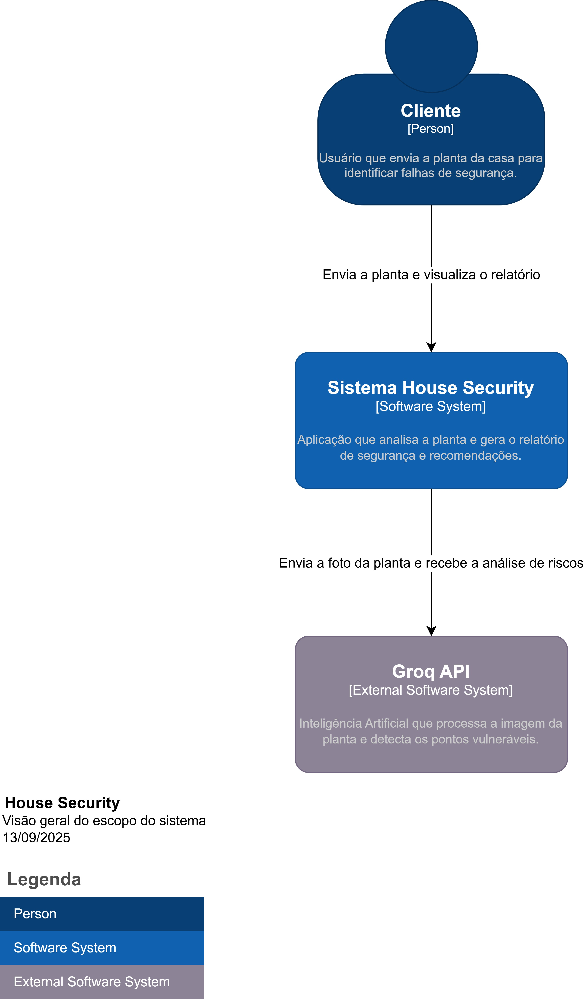
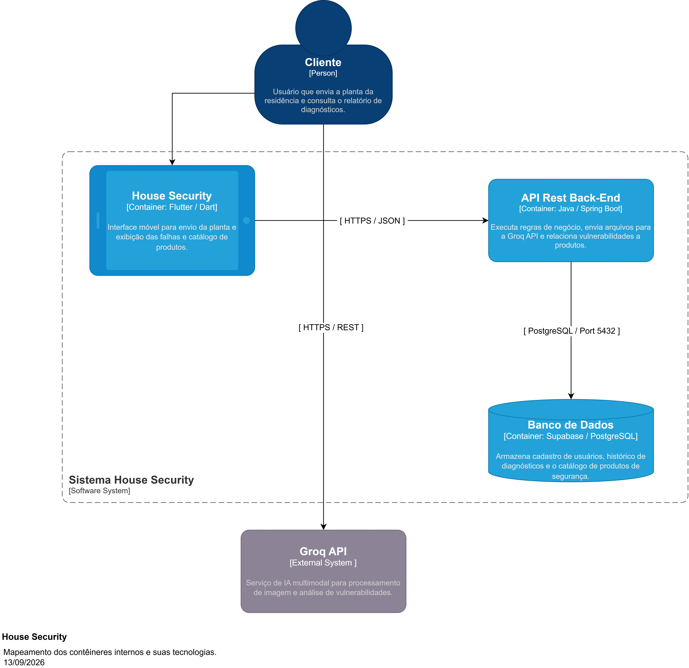

# House Security

> **Vídeo Final de Apresentação e Demonstração (5 a 10 min):** **[COLE AQUI O LINK DO VÍDEO FINAL NO YOUTUBE / DRIVE / LOOM]**  
> **Apresentação do Projeto (Pitch Deck):** **[COLE AQUI O LINK DOS SLIDES NO CANVA OU ARQUIVO PDF]**

---

## Sumário
- [1. Sobre o Projeto](#1-sobre-o-projeto)
- [2. ODS Escolhida](#2-ods-escolhida)
- [3. O Problema Real](#3-o-problema-real)
- [4. A Solução com Inteligência Artificial](#4-a-solução-com-inteligência-artificial)
- [5. Público-Alvo](#5-público-alvo)
- [6. Modelagem de Dados (UML)](#6-modelagem-de-dados-uml)
- [7. Arquitetura do Sistema (Modelo C4)](#7-arquitetura-do-sistema-modelo-c4)
- [8. Decisões Tecnológicas e Protocolos](#8-decisões-tecnológicas-e-protocolos)
- [9. Estrutura de Dados (MER) e Integração com IA](#9-estrutura-de-dados-mer-e-integração-com-ia)
- [10. Interface Mobile, Sessão e Integração com a API](#10-interface-mobile-sessão-e-integração-com-a-api)
- [11. Infraestrutura em Nuvem (SaaS) e MVP](#11-infraestrutura-em-nuvem-saas-e-mvp)
- [12. Apresentação Final (Pitch Deck) e Retrospectiva](#12-apresentação-final-pitch-deck-e-retrospectiva)

## 1. Sobre o Projeto
O **House Security** é uma evolução do projeto de segurança residencial do primeiro semestre. A aplicação móvel permite que o morador envie a **planta da sua residência** (em formato de imagem) para que uma Inteligência Artificial realize um diagnóstico preventivo automático, identificando pontos vulneráveis e recomendando soluções técnicas integradas ao catálogo de produtos da empresa.

## 2. ODS Escolhida
**ODS 16 – Paz, Justiça e Instituições Eficazes**

Nosso time escolheu essa ODS porque a segurança residencial é um problema real de qualidade de vida na cidade e de acesso desigual à proteção. Nem todo mundo tem condições de pagar por uma consultoria de segurança particular ou instalar um sistema caro — e é aí que a House Security entra: usando IA, o app democratiza o acesso à prevenção de riscos, ajudando a deixar as comunidades mais seguras de um jeito acessível.

## 3. O Problema Real
Muita gente não faz ideia de onde a própria casa está vulnerável. Coisas como iluminação fraca, acesso exposto ou falha de cobertura passam batido no dia a dia, e o morador só descobre a fragilidade depois que já aconteceu algo. Existe consultoria de segurança que faz esse diagnóstico, mas custa caro e não é opção real para a maioria das famílias. Falta um jeito barato e acessível de qualquer um entender os riscos da própria casa e saber o que fazer para melhorar.

## 4. A Solução com Inteligência Artificial
O diferencial do House Security é usar IA para transformar uma foto simples em diagnóstico de segurança:

- *Análise de imagem por IA:* a IA analisa a foto da planta do imóvel para achar pontos vulneráveis — como iluminação fraca, acesso exposto ou falha de cobertura.
- *Geração de recomendação:* com os dados em mãos, o sistema monta um relatório automático com mapa de risco da casa e um plano de ação prático e personalizado para melhorar a segurança.

Ou seja, a IA não é só enfeite — ela é o motor que transforma uma planta baixa em um diagnóstico prático, algo que normalmente só uma consultoria especializada faria.

## 5. Público-Alvo
Moradores de casas ou apartamentos que querem entender e melhorar a segurança do próprio lar, mas não têm orçamento para pagar uma consultoria especializada — principalmente moradores de bairros com pouco recurso de segurança pública ou privada, que são justamente quem mais ganha com uma ferramenta acessível de diagnóstico preventivo.

## 6. Modelagem de Dados (UML)

## 7. Arquitetura do Sistema (Modelo C4)
A arquitetura do **House Security** foi desenhada utilizando a metodologia do **C4 Model**. Essa abordagem nos permite visualizar a plataforma sob diferentes perspectivas: desde o impacto direto no usuário até a estrutura técnica que roda no servidor.

### Nível 1: Diagrama de Contexto
A aplicação funciona como uma plataforma inteligente de prevenção de riscos. O objetivo do Nível 1 é demonstrar a visão macro do produto, focando em como o sistema se conecta ao usuário e a serviços parceiros, sem se prender a detalhes internos de código.

- *Cliente `[Pessoa]`:* O morador que envia a imagem da planta da sua residência para identificar pontos fracos de proteção e receber diagnósticos práticos para o dia a dia.
- *Sistema House Security `[Sistema de Software]`:* O ecossistema central da aplicação. É responsável por receber a solicitação do cliente, gerenciar o fluxo de análise e entregar o relatório final junto às soluções recomendadas.
- *Groq API `[Sistema Externo]`:* A plataforma de inteligência artificial integrada que interpreta o layout visual das plantas baixas e mapeia automaticamente os pontos vulneráveis do imóvel.

### Nível 2: Diagrama de Contêineres
Abrindo a estrutura para entender o que acontece por baixo dos panos, dividimos o sistema em unidades independentes (contêineres). Essa separação garante que o aplicativo seja ágil, seguro e simples de manter.

- *Aplicativo Mobile `[Flutter / Dart]`:* A interface direto na mão do usuário. Criada para oferecer uma experiência leve e fluida no celular, a aplicação cuida do envio das imagens, da consulta ao histórico de laudos e da exibição amigável do relatório de segurança.
- *Back-End `[Java / Spring Boot]`:* O cérebro da arquitetura. Esta API REST assume o trabalho pesado do sistema: valida as informações do app, envia as imagens para processamento na IA, salva os resultados e gerencia o histórico de análises do usuário.
- *Banco de Dados `[Supabase / PostgreSQL]`:* A camada de armazenamento em nuvem. Guarda com segurança as contas dos usuários e todo o histórico de diagnósticos gerados.
- *Serviço de IA `[Groq API]`:* O motor externo acionado pelo Back-End para realizar a análise visual da planta baixa e retornar o diagnóstico estruturado de vulnerabilidades.

## 8. Decisões Tecnológicas e Protocolos
Para construir o **House Security**, escolhemos cada tecnologia buscando um equilíbrio entre desempenho, segurança e boa organização do código.

**Tecnologias do Projeto**
- *Mobile (Flutter / Dart):* Usamos o Flutter para criar a aplicação móvel com uma única base de código. Além de deixar a navegação leve para o usuário, ele facilita o upload de imagens da galeria e a captura pela câmera do dispositivo.
- *Back-End (Java / Spring Boot):* O Java com Spring Boot atua como o motor central da aplicação. Essa tecnologia nos dá a estrutura necessária para criar uma API REST organizada e segura, cuidando das regras de validação e fazendo a ponte entre o aplicativo, a inteligência artificial e o banco de dados.
- *Banco de Dados (Supabase / PostgreSQL):* Escolhemos o Supabase por oferecer um banco relacional PostgreSQL gerenciado em nuvem com alta disponibilidade, garantindo o armazenamento seguro dos cadastros de usuários e do histórico de relatórios gerados.
- *Inteligência Artificial (Groq API):* Integramos a API da Groq utilizando modelos multimodais de visão computacional pela baixa latência de resposta e precisão na leitura de layouts arquitetônicos, permitindo identificar pontos críticos de vulnerabilidade em segundos.

**Protocolos e Comunicação**
- *HTTPS:* Como lidamos com imagens de imóveis e informações pessoais, o protocolo HTTPS é indispensável para garantir que os dados trafeguem com criptografia entre o aplicativo, a API e os serviços em nuvem.
- *REST e JSON:* A comunicação entre o aplicativo e a API segue o padrão REST, trocando dados no formato JSON. É uma estrutura leve e rápida para enviar as requisições de análise e receber o diagnóstico estruturado.
- *PostgreSQL / Porta 5432 (SSL):* É o canal direto e criptografado entre a nossa API em Java e o banco de dados na nuvem (Supabase), garantindo conexões estáveis para gravação e consulta dos laudos.

## 9. Estrutura de Dados (MER) e Integração com IA

### Modelagem do Banco de Dados (MER)
Para garantir a persistência e a integridade das informações em nuvem, o banco de dados relacional no **Supabase (PostgreSQL)** foi estruturado em quatro tabelas principais:

- **`cliente`:** Armazena os dados cadastrais e de endereço dos moradores (`id_cliente`, `cpf`, `nome`, `email`, `senha`, `cep`, `rua`, `numero` e `telefone`).
- **`atestado`:** Registra cada diagnóstico gerado pelo sistema (`id_atestado`, `url_arquivo`, `analise_ia` e `criacao`), vinculado ao morador por meio da chave estrangeira `id_cliente`.
- **`produtos`:** Mantém o catálogo de equipamentos e soluções de segurança disponíveis (`id_produto`, `categoria`, `marca` e `preco`).
- **`produtoatestado`:** Tabela associativa que conecta os diagnósticos (`id_atestado`) aos equipamentos recomendados (`id_produto`) e suas respectivas quantidades (`quantidade`).

### Fluxo da API REST e Processamento com IA
A comunicação entre o aplicativo móvel e a Inteligência Artificial é intermediada pela API REST em **Java / Spring Boot**, garantindo que chaves de acesso e regras de negócio fiquem protegidas no servidor:

1. **Envio e Validação (`POST /api/analise`):** O aplicativo envia a imagem da planta baixa para o Back-End, que valida se o arquivo corresponde realmente a uma planta arquitetônica residencial.
2. **Análise Multimodal (Groq API):** O serviço encaminha a imagem acompanhada de um *prompt* técnico estruturado para o modelo de visão computacional da Groq, que mapeia vulnerabilidades por camada de proteção e gera o plano de ação.
3. **Persistência e Consulta (`GET` / `DELETE`):** O laudo retornado pela IA é gravado na tabela `atestado` no PostgreSQL, permitindo que o morador consulte ou exclua relatórios anteriores diretamente na tela de histórico do aplicativo.

## 10. Interface Mobile, Sessão e Integração com a API
O aplicativo desenvolvido em **Flutter** conecta a experiência visual do morador diretamente aos endpoints da API REST:

- **Tela Principal e Envio de Planta:** Permite selecionar a imagem de uma planta residencial da galeria ou câmera, acionar a análise e visualizar o laudo técnico formatado.
- **Histórico de Análises:** Tabela responsiva que lista os diagnósticos anteriores do usuário, permitindo abrir o relatório completo ou excluir registros antigos.
- **Autenticação e Gerenciamento de Sessão:** **[PENDENTE — DESCREVER AQUI COMO FUNCIONA O LOGIN, CADASTRO E CONTROLE DE SESSÃO DO USUÁRIO LOGADO APÓS FINALIZAR ESTA ETAPA]**

> **Vídeo Explicativo — Primeira Tela e Comunicação com a API (3 a 5 min):** **[COLE AQUI O LINK DO VÍDEO EXPLICANDO O CÓDIGO E A CHAMADA HTTP DA TELA]**

## 11. Infraestrutura em Nuvem (SaaS) e MVP
Para operar como um serviço disponível pela internet sem depender de servidores locais, a infraestrutura do **House Security** foi implantada em nuvem:

- **API Back-End Hospedada (Render):** `https://house-security-api.onrender.com`
- **Banco de Dados Gerenciado em Nuvem:** **Supabase (PostgreSQL)**

> **Vídeo Demonstração — Sistema na Nuvem e MVP Funcionando (3 a 5 min):** **[COLE AQUI O LINK DO VÍDEO MOSTRANDO O APP CONECTADO À API NO RENDER E SALVANDO NO SUPABASE]**

## 12. Apresentação Final (Pitch Deck) e Retrospectiva
Nesta etapa final, consolidamos a jornada de desenvolvimento, as decisões técnicas, os desafios superados e os próximos passos do produto:

- **Apresentação de Slides (Pitch Deck):** **[COLE AQUI O LINK DA APRESENTAÇÃO NO CANVA OU PDF NO REPOSITÓRIO]**
- **Vídeo Final de Apresentação e Demonstração (5 a 10 min):** **[COLE AQUI O LINK DO VÍDEO FINAL COM SLIDES, DEMONSTRAÇÃO DO APP E RETROSPECTIVA DO GRUPO]**
